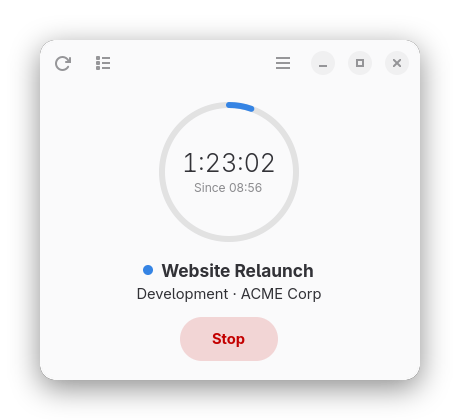

# Stempeluhr for macOS — menu-bar time clock

A native macOS **menu-bar app** (a "widget" for your menu bar) that starts and
stops time tracking in [Kimai](https://www.kimai.org/), ported from the GNOME
app in this repository. It lives in the menu bar, shows the running timer, and
clocks you in and out with one click.



*(screenshot above is the original GNOME app; the Mac version shows the same
information as a menu-bar popover.)*

## What it does

- A **stopwatch icon** in the menu bar, with the ticking `H:MM` while a timer
  runs.
- Click it for a small panel: the live elapsed time (computed from the server's
  `begin`, not counted up locally), the project · activity, and a big
  **Start / Stop** button.
- Pick a project and activity to start; the last choice is remembered.
- **Kimai is the single source of truth.** The panel only shows what the server
  last confirmed. If the server can't be reached, the last state is shown and
  marked *"Not confirmed"*. `POST`/`PATCH` are never retried — after an
  uncertain failure the server is asked what happened instead. (Same design as
  the GNOME app; see the root `README.md`.)
- The API token is stored in the **macOS Keychain**, never in preferences or
  logs.

This is the quiet core of the original: start, stop, and current state. The
history / edit page is not (yet) ported.

## Requirements

- macOS 13 (Ventura) or newer
- Xcode command-line tools / Swift 5.9+ (to build)

## Build & run

```sh
cd macos
./scripts/build-app.sh          # builds macos/build/Stempeluhr.app (ad-hoc signed)
open build/Stempeluhr.app
```

A stopwatch appears in your menu bar. Click it, enter your Kimai server
(`https://kimai.example.com`) and an API token (**Kimai → profile → API →
create token**), and press **Connect**. The connection is tested before
anything is saved.

To open the project in Xcode instead, just open `macos/Package.swift`.

### Install it permanently

Move the built app into Applications and (optionally) add it as a login item:

```sh
cp -R build/Stempeluhr.app /Applications/
```

Then add it under **System Settings → General → Login Items** so it starts with
your Mac.

## Try it without a Kimai server

The repository ships a mock server:

```sh
python3 ../build-aux/mock-kimai.py        # http://127.0.0.1:8765, token: testtoken
```

Connect the app to `http://127.0.0.1:8765` with token `testtoken`.

## Self-test (no GUI)

The same binary can run a headless end-to-end check of the Kimai client
(connect → list → start → active → stop) against a running server:

```sh
swift build
.build/debug/Stempeluhr selftest http://127.0.0.1:8765 testtoken
```

## Layout

| Path                         | What                                                        |
| ---------------------------- | ---------------------------------------------------------- |
| `Sources/Stempeluhr/KimaiClient.swift` | REST client (Bearer auth, tolerant parsing, idempotent GET retries) |
| `KimaiModels.swift` / `KimaiTime.swift` | Decoding of ids-or-objects, PHP `+0100` offsets, clock offset |
| `AppStore.swift`             | State machine + polling (every 45 s, on wake, around writes) |
| `MenuContentView.swift` / `ConnectView.swift` | SwiftUI popover and onboarding          |
| `Keychain.swift`             | Token storage in the login keychain                        |
| `Main.swift`                 | Entry point + `selftest` mode                              |
| `scripts/build-app.sh`       | Bundles the executable into `Stempeluhr.app`               |

GPL-3.0-or-later, like the rest of the project.
